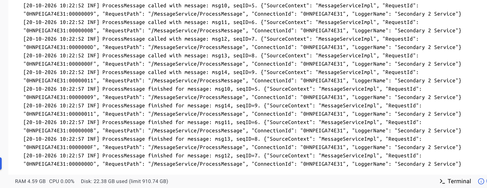

# Replication log application
## Installation
To run the application run these commands in the parent folder:
```
docker compose build --no-cache
docker-compose up -d master-service secondary1-service secondary2-service
docker compose run grpc-client
```
Successful installation includes creating 3 services(master and 2 secondaries)
and running console application.

## Write Concern
Write concern logic is tested in GrpcClient, 5s delay is introduced on the second service- 
messages are sent to master service with different write concern parameters-
note that task3 is sent with writeconcern=3, which means that master waits for it to response,
but is not blocked and process msg4(sent in task4 with writeconcern=1).

Master and secondaries also temporarily return different message lists - that are in sync after rerun.

## Reodering
Secondary1 service has IsReorderingEnabled app setting set to true, that adds a random delay,
emulating messages arriving in a different sequence.
In secondaries logs that sequence number can be checked.
Grpc Client sends 5 messages to master, secondary1 stores them ordered, despite of emulated reordering.
Below are the screenshots of secondary service logs-
in what order messages were sent from master and how they were processed in secondaries.



Reodering can be turned on /off using by setting IsReorderingEnabled parameter in appsettings.*SecondaryService*.json
Access appsettings file of each service from container->Bind Mounts.

## Logging
Logs can be found on container->Logs screen.

Another option - Logs from calling get/post messages for each service(master and secondaries) can be found in 
docker desktop-> select container(i.e. master-service)-> Files->app->logs-> 
'grpcservice_log_master.txt'( for secondaries corresponding files are 'grpcservice_log_secondary1.txt',
'grpcservice_log_secondary2.txt'). 

## Changing replication lag(service delay)
In order to change service delay,
update DelayInSec setting in ServiceConfig block of each service appsetting.*servicename*.json file
(appsettings.Master.json, appsettings.Secondary1.json, appsettings.Secondary2.json)
and save corresponding appsetting file - delay will be updated automatically.

Access appsettings file of each service from container->Bind Mounts.

## Integration Tests
In order to test different replication duration with different write concerns,
run tests from MessageServiceTests project.
