# Replication log application
## Installation
To run the application run these commands in the parent folder:
```
docker compose build --no-cache
docker-compose up -d master-service secondary1-service secondary2-service
docker compose run grpc-client
```
Successful installation includes creating 3 services(master and 2 secondaries)
and running console application.

## Secondary Service is not available and restores later
To set that secondary service is not available - 
set IsAvailable setting to false in app.settings of a corresponding service.
<br>Client responses and logs:

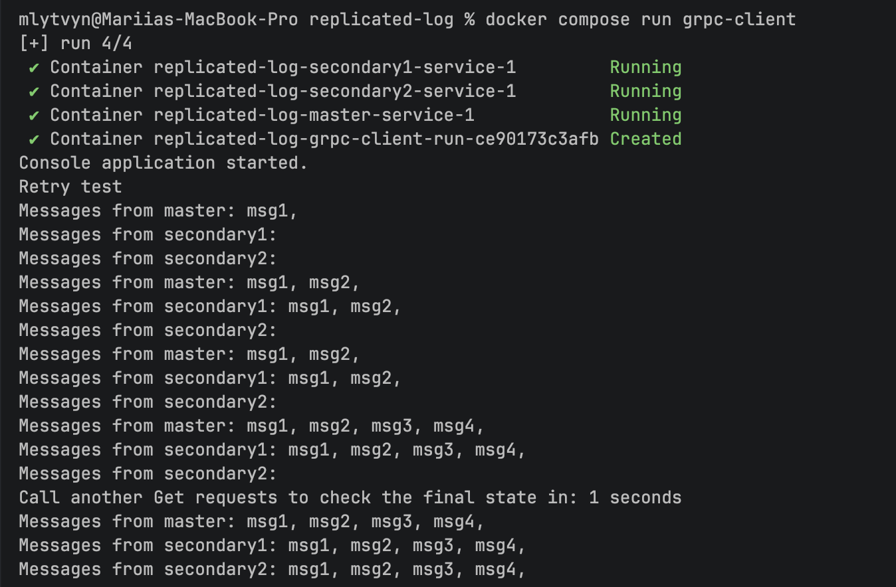
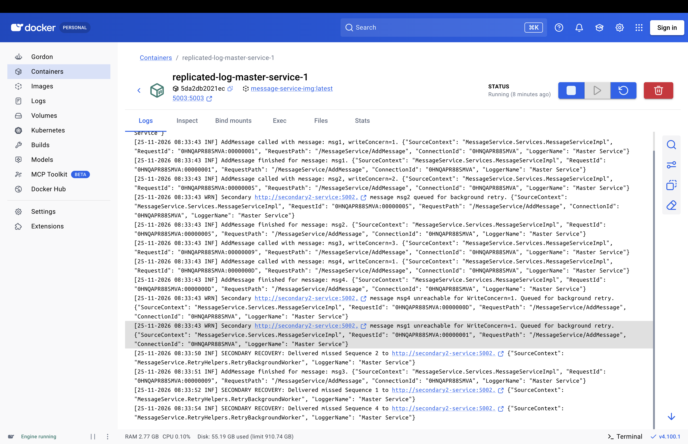

## Secondary Service is not available and doesn't restore later
In case secondary service is down and doesn't restore - app performs health checks
every n seconds(set in RetryIntervalInSec setting of master service).
If WriteConcern = All and  secondary service doesn't return healthy status, then 
application waits for TimeoutInSec (set in master service) and then switches to 
polling health status from a background worker to ensure eventual consistency.

<br>Client response when secondary2 is down:
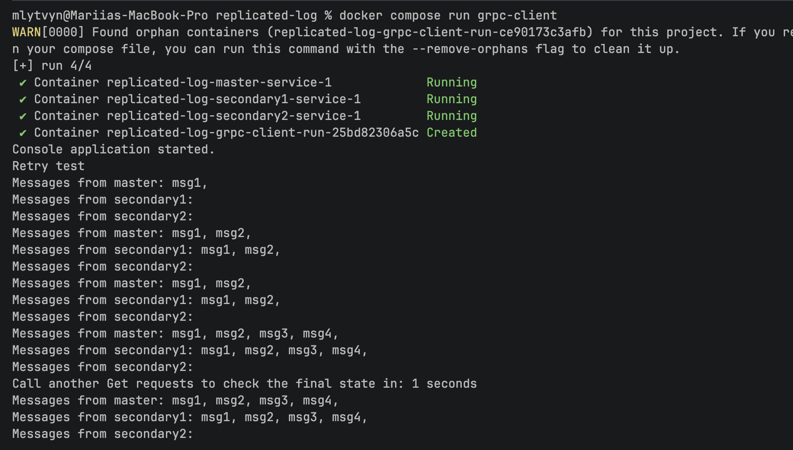
Logs from master service (timeout exceeded-switched to background worker)
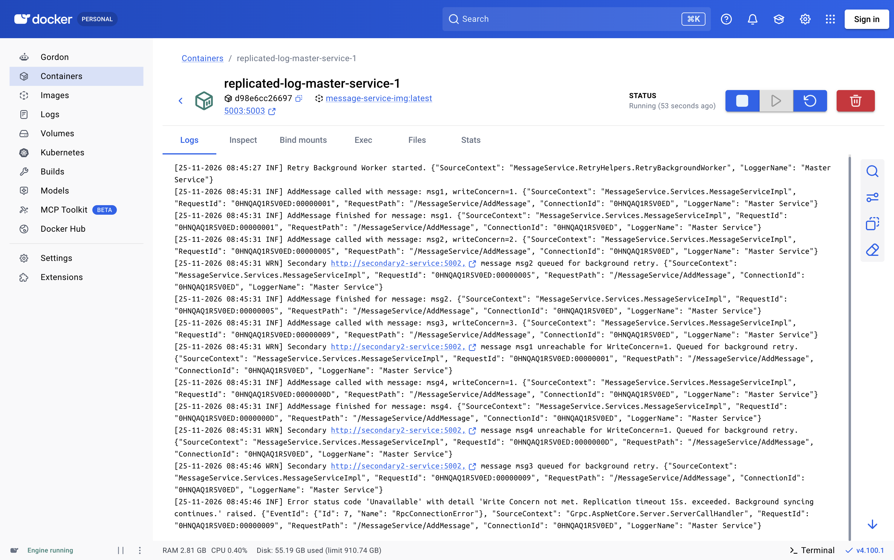
Master performs health checks on secondary 2:
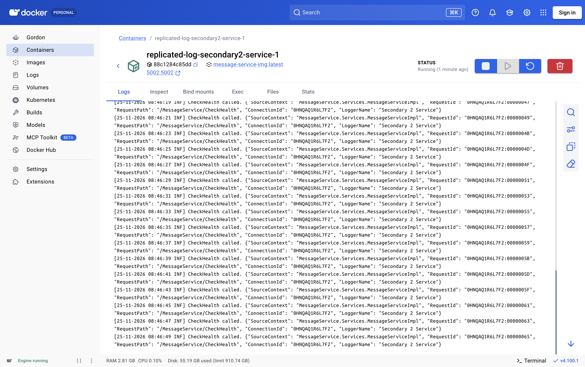
Secondary 2 restores:
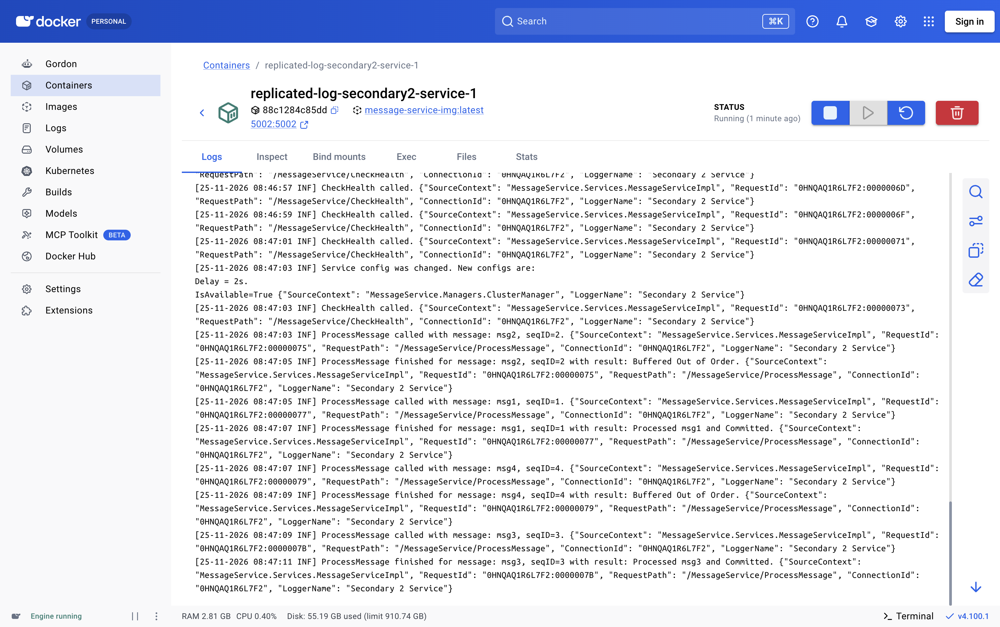
Master restoration logs:
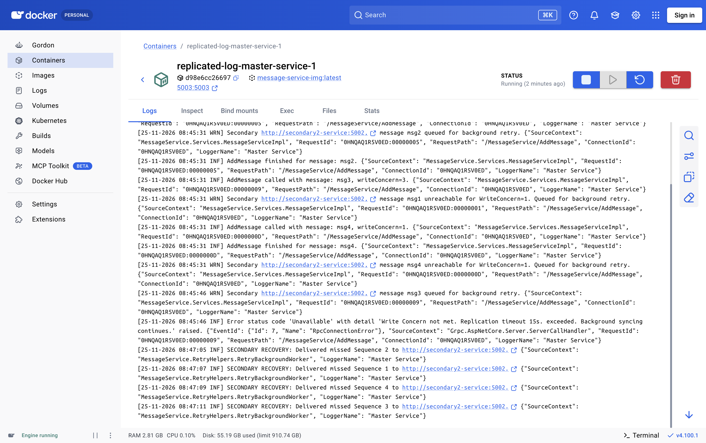
Checking that messages are present and ordered:
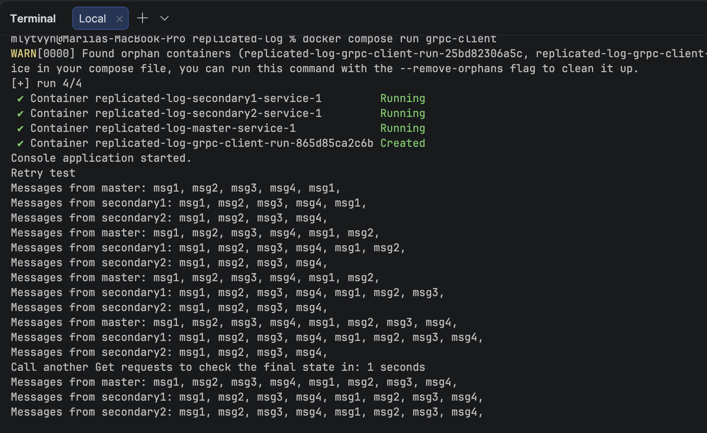

## Reodering
Secondary1 service has IsReorderingEnabled app setting set to true, that adds a random delay,
emulating messages arriving in a different sequence.
In secondaries logs that sequence number can be checked.
<br>Grpc Client sends 6 messages to master, secondaries stores them ordered, despite of emulated reordering.
<br>Below are the screenshots of secondaries service logs-
can be checked in what order messages were sent from master and how they were processed in secondaries.
<br>Note that Secondary 2 has replication lag 2 sec in addition to reordering enabled.
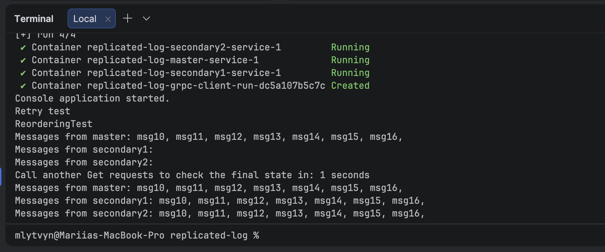
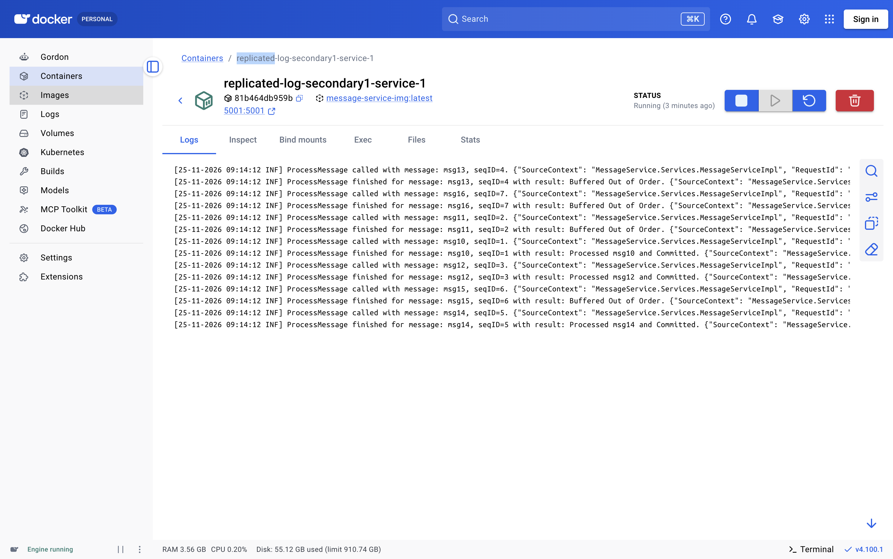
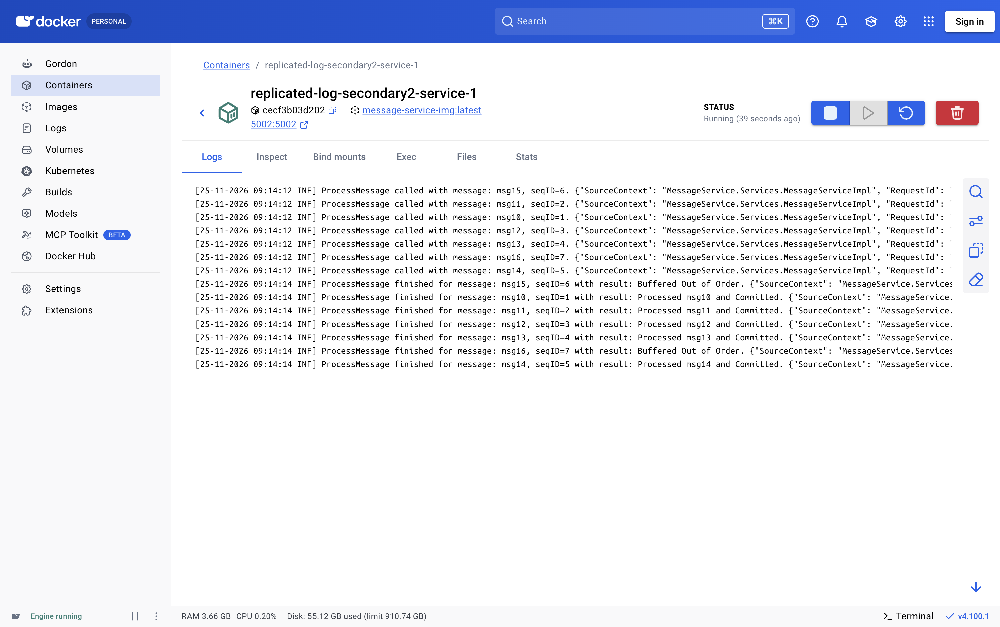

Reodering can be turned on /off using by setting IsReorderingEnabled parameter in appsettings.*SecondaryService*.json
Access appsettings file of each service from container->Bind Mounts.

## Logging
Logs can be found on container->Logs screen.

Another option - Logs from calling get/post messages for each service(master and secondaries) can be found in 
docker desktop-> select container(i.e. master-service)-> Files->app->logs-> 
'grpcservice_log_master.txt'( for secondaries corresponding files are 'grpcservice_log_secondary1.txt',
'grpcservice_log_secondary2.txt'). 

## Changing replication lag(service delay)
In order to change service delay,
update DelayInSec setting in ServiceConfig block of each service appsetting.*servicename*.json file
(appsettings.Master.json, appsettings.Secondary1.json, appsettings.Secondary2.json)
and save corresponding appsetting file - delay will be updated automatically.

Access appsettings file of each service from container->Bind Mounts.
